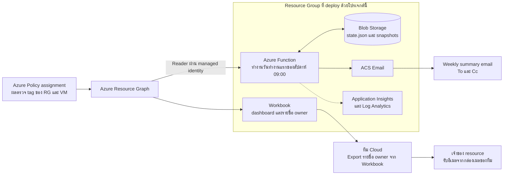
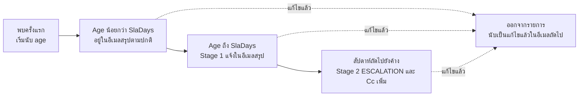

# azure-tag-governance-monitor

> Weekly tag-governance monitoring for Azure on top of Azure Policy. Resource Graph snapshot, Workbook dashboard and age-based escalation emails, built with Azure Functions, ACS Email and Bicep.

ระบบนี้ช่วยให้องค์กรทราบว่า Resource Group (RG) และ Virtual Machine (VM) รายการใดยังกำหนด tag ไม่ครบถ้วน แต่ละรายการค้างมานานเท่าใด และแจ้งเตือนผู้ที่เกี่ยวข้องอย่างสม่ำเสมอโดยไม่ต้องตรวจสอบด้วยตนเอง

repository นี้พัฒนาต่อจาก [`azure-policy-rg-vm-tag-governance`](https://github.com/kamonphank/azure-policy-rg-vm-tag-governance) ซึ่งสร้าง Policy initiative สำหรับตรวจสอบ tag ด้วย effect `Audit` โดย repository นี้ไม่ได้สร้าง Policy ใหม่ แต่นำผลการประเมินของ Policy assignment ดังกล่าวมาจัดทำรายงานและการแจ้งเตือน จึงต้อง deploy repository นั้นก่อน

ขั้นตอนการ deploy และคำอธิบายการตั้งค่าทั้งหมดอยู่ใน **[docs/DEPLOY.md](docs/DEPLOY.md)**

**Contents**

- [Purpose](#purpose)
- [Architecture](#architecture)
- [Weekly workflow](#weekly-workflow)
- [Age and escalation](#age-and-escalation)
- [Email recipients](#email-recipients)
- [Data and permissions](#data-and-permissions)
- [Repository structure](#repository-structure)

## Purpose

Azure Policy ตรวจสอบ tag ให้อยู่แล้ว แต่รายงานได้เพียงจำนวนรายการที่ไม่ผ่านในขณะนั้น ไม่ระบุว่าแต่ละรายการค้างมานานเท่าใด และไม่แจ้งเตือนผู้ที่เกี่ยวข้อง ระบบนี้จึงเพิ่มความสามารถ 3 ประการดังนี้

1. **Dashboard** ผ่าน Workbook ซึ่งแสดงจำนวนรายการที่ไม่ผ่านแยกตามสาเหตุ และมีรายชื่อ owner ที่ export เป็นไฟล์ได้
2. **Age tracking** โดยบันทึกวันที่ตรวจพบรายการครั้งแรกไว้ใน Blob Storage
3. **Age-based escalation** โดยส่งอีเมลสรุปรายสัปดาห์ และแจ้งผู้จัดการเพิ่มเมื่อรายการค้างเกินกำหนด

หากทุกรายการผ่านการตรวจสอบแล้ว ระบบจะไม่ส่งอีเมล

## Architecture

| Component | Purpose |
|---|---|
| Azure Policy assignment | เป็น single source of truth ระบบนี้ไม่ได้ตรวจสอบ tag เอง แต่ใช้ผลที่ Policy ประเมินไว้แล้ว |
| Azure Resource Graph | ช่องทางอ่านผลของ Policy พร้อมข้อมูล tag ของ RG และ VM โดย Function และ Workbook ใช้ query ที่มีตรรกะเดียวกัน ตัวเลขที่แสดงจึงสอดคล้องกัน |
| Azure Function | เริ่มทำงานตามเวลาที่กำหนด ดึงรายการที่ไม่ผ่าน เปรียบเทียบกับ state เดิมเพื่อคำนวณ age และพิจารณาว่าจะส่งอีเมลหรือไม่ |
| Blob Storage | เก็บ `state.json` (วันที่ตรวจพบครั้งแรกและสถานะ escalation) และ snapshot รายสัปดาห์เป็นหลักฐานย้อนหลัง |
| Workbook | dashboard สำหรับเปิดดู และ export รายชื่อ owner เพื่อใช้ส่งอีเมลต่อ |
| ACS Email | ส่งอีเมลสรุปไปยังผู้รับที่กำหนด |
| Application Insights และ Log Analytics | เก็บ log การทำงานของ Function |

ระบบไม่ได้ส่งอีเมลถึงเจ้าของ resource แต่ละรายโดยอัตโนมัติ ทีม Cloud เป็นผู้ export รายชื่อจาก Workbook และส่งอีเมลจากกล่องเมลของทีม เนื่องจากจำนวนรายการอยู่ในระดับหลักสิบ และการส่งจากกล่องเมลของทีมทำให้เจ้าของ resource ตอบกลับผู้ส่งจริงได้ ลดปัญหาอีเมลถูกจัดเป็น Junk และไม่ต้องพัฒนากลไกส่งอีเมลถึงผู้รับจำนวนมากในโค้ด

## Weekly workflow

Function เริ่มทำงานทุกวันจันทร์ถึงศุกร์ เวลา 09:00 น. ตามเวลาประเทศไทย แต่ส่งอีเมลเฉพาะใน **วันทำงานแรกของสัปดาห์** หากวันจันทร์ตรงกับวันหยุดที่ระบุไว้ใน `function/holidays.json` ระบบจะเลื่อนไปส่งในวันทำงานถัดไป

ในแต่ละรอบ Function ดำเนินการตามลำดับดังนี้

1. ดึงรายการ RG และ VM ที่ไม่ผ่านจาก Resource Graph
2. เปรียบเทียบกับ `state.json` เพื่อระบุรายการใหม่ รายการที่แก้ไขแล้ว และ age ของรายการที่ยังค้างอยู่
3. จัดรายการที่ค้างนานเข้าสู่ Stage 1 หรือ Stage 2
4. ส่งอีเมลสรุปหากมีรายการค้างอยู่
5. บันทึก `state.json` และ snapshot ของสัปดาห์นั้น

## Age and escalation

Age ของรายการ คือจำนวนวันนับจากวันที่ระบบตรวจพบรายการนั้นครั้งแรก หากรายการได้รับการแก้ไขแล้วกลับมาไม่ผ่านอีก ระบบจะเริ่มนับ age ใหม่

| Stage | Condition | System action |
|---|---|---|
| Regular | Age น้อยกว่า `SlaDays` | แสดงรายการในตารางของอีเมลสรุป |
| Stage 1 | Age ถึง `SlaDays` (ค่าเริ่มต้น 14 วัน) และยังไม่เคยถูก escalate | แจ้งเป็นหัวข้อ "ค้างเกิน" ในอีเมลสรุปถึงผู้รับหลัก |
| Stage 2 | เคยถูกแจ้งใน Stage 1 เมื่อสัปดาห์ก่อนและยังค้างอยู่ | หัวเรื่องอีเมลขึ้นต้นด้วย `[ESCALATION]` และเพิ่มผู้รับ Cc ตามที่กำหนดใน `MailCcEscalation` |

การ escalate พิจารณาจาก age ของรายการ ไม่ได้พิจารณาจากจำนวนรายการที่คงเหลือ เนื่องจากหากมีรายการใหม่เกิดขึ้นระหว่างที่ทีมกำลังแก้ไขรายการเดิม จำนวนรวมอาจไม่ลดลงทั้งที่ทีมดำเนินการอยู่

## Email recipients

| Recipient | Receives | Config key |
|---|---|---|
| ผู้รับหลัก (To) | อีเมลสรุปทุกฉบับ | `MailTo` |
| Cc ทุกฉบับ | อีเมลสรุปทุกฉบับ เหมาะสำหรับผู้จัดการที่ต้องการติดตามภาพรวมอย่างต่อเนื่อง | `MailCc` |
| Cc เฉพาะ Stage 2 | เฉพาะอีเมลที่มีรายการถูก escalate | `MailCcEscalation` |

## Data and permissions

- Function ใช้ managed identity ซึ่งได้รับสิทธิ์ **Reader** ระดับ subscription เป็นสิทธิ์อ่านอย่างเดียว ไม่มีสิทธิ์เขียนหรือลบข้อมูล
- ข้อมูลที่ระบบจัดเก็บอยู่ใน Blob ของบัญชีขององค์กรเอง ได้แก่ ชื่อและ ID ของ RG และ VM ที่ไม่ผ่าน ค่า tag `owner` (ซึ่งมักเป็นอีเมล) และวันที่ตรวจพบครั้งแรก ระบบไม่เก็บข้อมูลภายในตัว VM
- ค่าเริ่มต้นถูกกำหนดให้ปลอดภัย กล่าวคือ ระบบไม่ส่งอีเมลจนกว่าผู้ดูแลจะเปิดใช้งาน และ endpoint ทดสอบ `/api/run` ปิดอยู่
- config จริง (Subscription ID, ชื่อ RG และอีเมล) ไม่ถูกเก็บใน repository โดยมีเฉพาะไฟล์ตัวอย่าง และมีสคริปต์ตรวจสอบก่อน commit เพื่อป้องกันข้อมูลจริงหลุดไปยัง public repository ดังรายละเอียดใน [docs/DEPLOY.md](docs/DEPLOY.md)

ข้อจำกัดที่ควรทราบก่อนนำไปใช้ในองค์กร

- storage key และ ACS connection string ถูกเก็บไว้ใน App settings ของ Function ผู้ที่มีสิทธิ์ Contributor บน Resource Group มองเห็นได้ จึงควรจำกัดสิทธิ์บน Resource Group นี้ และหากนโยบายขององค์กรกำหนด ควรย้ายไปใช้ Key Vault reference ซึ่ง repository นี้ยังไม่ได้ดำเนินการ
- สิทธิ์ Reader ระดับ subscription อ่าน metadata ของทุก resource ได้ หากต้องการจำกัดขอบเขต ให้กำหนด `ScanSubscriptionIds` หรือมอบสิทธิ์ในขอบเขตที่เล็กกว่าด้วยตนเอง

## Repository structure

| Path | Purpose |
|---|---|
| `function/` | Azure Function (Python 3.11) ประกอบด้วย `function_app.py` และ `tag_governance/` (ตรรกะทั้งหมด) และ `holidays.json` |
| `infra/` | Bicep สำหรับสร้าง Storage, Function App, ACS Email, Workbook และกำหนดสิทธิ์ Reader |
| `workbook/` | ไฟล์ JSON ของ Workbook |
| `scripts/deploy.ps1` | สคริปต์ deploy ทั้งชุด โดยอ่านค่าจากไฟล์ config |
| `config/deploy.config.example.psd1` | ไฟล์ config ตัวอย่าง (ไฟล์จริงถูกกำหนดใน `.gitignore`) |
| `tests/` | test suite (pytest) ครอบคลุมตรรกะวันส่ง age และการ escalate โดยไม่ต้องใช้ Azure |
| `docs/DEPLOY.md` | คู่มือการ deploy และการตั้งค่า |